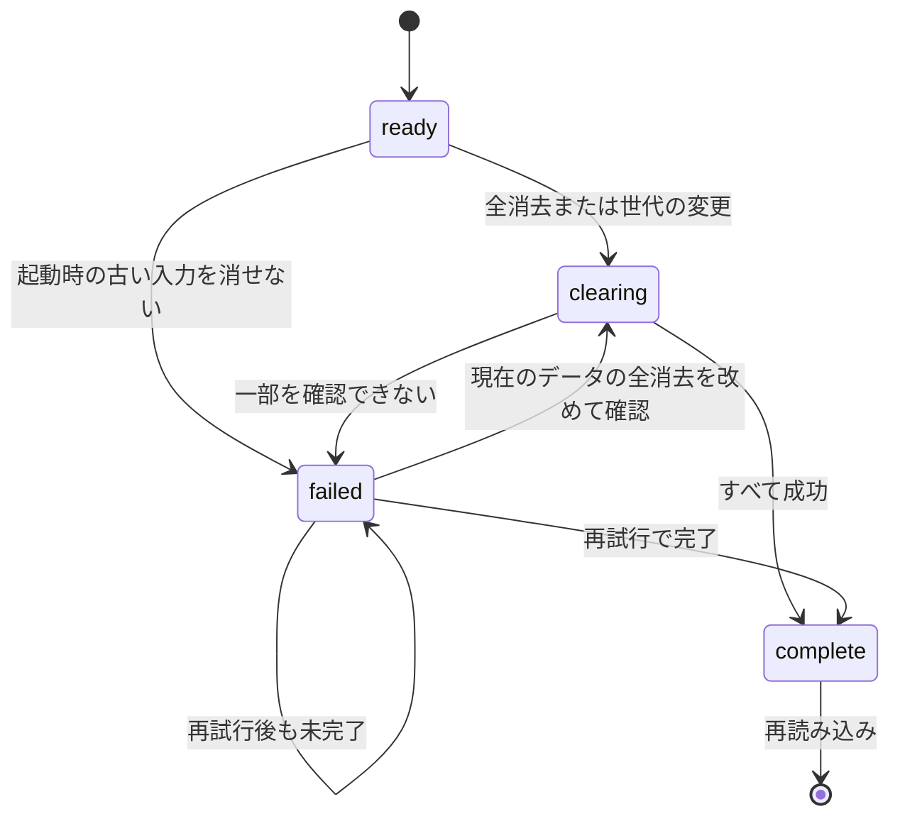

# 入力と表示設定の保存

入力・表示設定・機密値をどこに置き、全消去やタブ間の通知とどう調整するかをまとめます。localStorage に入力を保存しない理由は [SECURITY.md](../SECURITY.md#既知の制約) の「同じオリジンのほかのサイト」、利用者向けの操作と復旧方法は [USAGE.md](USAGE.md#保存消去編集履歴)、実装時の必須ルールは [CONTRIBUTING.md](../CONTRIBUTING.md) にあります。

## 保存先

| データ | 入口 | 保存先・管理 |
|---|---|---|
| 保存可能な入力 | `useInput` | sessionStorage（タブごと）にだけ保存する。localStorage には保存しない（理由は冒頭のリンク先） |
| 表示設定 | `usePreference` | 利用者が値を変えたときだけ保存する（復元・別タブからの通知・再描画では保存せず、別タブで変えた値を書き戻さない）。読み込みと保存の両方で同じ検証関数を使い、通った値だけをlocalStorageへ保存（通らない間は直前の有効な値を残す） |
| トークン・鍵などの機密値 | `useState` | メモリ内だけで保持 |
| 編集履歴 | `LargeTextInput` | メモリ内だけで保持 |

保存の処理は `src/lib/storage/` にまとめ、フォルダの外からは入口の `src/lib/storage/index.ts` だけを読み込みます（静的検査あり）。入口は、ロックと消去世代の決まりを守る操作と、読み取りに使う名前だけを公開します。フォルダの中のファイルの分担は、入口の先頭のコメントにあります。

## 保存キー

入力と表示設定のキーの先頭はツールID です（`dev-toolbox:input:bizdays:from`・`dev-toolbox:pref:bizdays:tab` など。型は `src/toolCatalog.ts` の `ToolId` から作る）。入力を保存するツールは、同じ一覧の `savesInput` で決めます。表示設定は `pref:` の名前空間に置き、入力・消去世代と分けます。表示設定の保存はロックを取らず、その設定のキーだけを操作します。ツールIDが保存キーの予約した先頭（`input`・`setting`・`event`・`pref`）・アプリ全体の設定と重ならないことは `src/registry.test.ts` で確かめます。

起動時には、描画の前に `prepareStorage`（`src/lib/storage/index.ts`）が、離れていた間の全消去を反映し（[保存と全消去の調整](#保存と全消去の調整)）、今の形式で使わないキーを消します（`src/lib/storage/preferences.ts` の `pruneStaleKeys`）。

- localStorage：今あるツール・アプリ全体の表示設定（`pref:`）と消去世代だけを残します。削除したツールの設定と、以前の版が残したキー（localStorage に保存していた入力・「入力内容を保存する」設定・名前空間のない表示設定など）は消します。
- sessionStorage：入力を保存するツールの入力（`input:<ツールID>…`）と、入力を保存した消去世代（`event:tab-generation`）だけを残します。

以前の版のデータは、移し替えずに消します。以前の版が localStorage に保存した入力は、残っていると同じオリジンのほかのサイトから読めるためです。古いキーが消えたことは、ほかのタブで全消去の通知として扱いません（新しく開いたタブが古いキーを消すたびに、開いているタブを全消去させないため）。

## 保存と全消去の調整

状態と通知は `src/lib/storage/clearState.ts`、保存領域の操作は `src/lib/storage/clearOperations.ts` が担当します。
`src/lib/storage/clear.ts` はロック・世代・ブラウザイベントを調整します。

`ready` 以外では入力の復元・保存を止めます。成功しても再読み込みまでは止めたままにします。

### 消去の発生元と復旧

| 発生元 | 削除・確認する範囲 | 失敗した場合 |
|---|---|---|
| このタブで全消去 | 共有の localStorage と自分の sessionStorage。先に消去世代を記録する | ツール画面を閉じ、未完了の操作と再試行を示す |
| 別タブからの通知 | 自分の sessionStorage だけ。共有領域には触れない | 自分のタブ内だけ削除を再試行する |
| 起動・セッション復元 | 記録した世代と現在の世代が違えば、古い入力を破棄する。記録がなく現在の世代がある場合も同じ | 世代を記録し直さず復元・保存を止める。購読開始後に失敗を示し、自分のタブ内だけ再試行する |
| 戻る・進むのキャッシュから復帰 | `pageshow` で世代を比較し、変わっていれば別タブの通知と同じ処理をする | 自分のタブ内だけ削除を再試行する |
| 通知の取りこぼし | 購読登録直後と他のキーの storage イベントでも世代を比較する | 世代が違えば消去へ進む。保存だけが止まった状態で放置しない |

消去を始めたタブでは、共有キーの未削除・列挙失敗、自分のタブ内削除、世代記録の結果を別々に持ちます。
再試行は自分のタブ内を削除し直し、共有領域は確認するだけです。
消去後に別タブが保存した値を消さないためです。
共有領域の再削除と世代の再記録には、現在のデータに対する新しい全消去の確認を使います。

### 通常の保存と競合

- 入力の編集は自分の sessionStorage にだけ保存します。失敗しても編集中の値をメモリに保持し、未保存を通知します。
- 全消去と保存が重なった場合は、通知前でも消去世代の変化を検出して書き戻しを止めます。
- 表示設定の更新関数には、読み直した保存値を渡します。他タブの変更を古い値で上書きしないためです。
- このタブの値が検証前の途中の値、または直前の保存に失敗した値なら、その値を更新の基準にします。

全消去は、`src/lib/storage/lock.ts` のロックで、別タブの全消去と順に処理します。タブ内保存と表示設定の保存はロックを取らず、即座に行います。ロックを利用できない環境でも、全消去を利用できます。

全消去では、入力や設定を含まないランダムな識別子を共有の消去世代として localStorage に残します。

- 消去を始めたタブは、世代を先に記録してから localStorage と自分の sessionStorage を消します（容量不足で記録できないときは、消してから記録し直します）。
- 共有の localStorage を消すのは消去を始めたタブだけで、通知を受けたタブは自分の sessionStorage だけを消します。
- 各タブは起動時の世代と現在の世代を更新直前に比較し、通知前でも消去前の入力を書き戻さないようにします。
- 消去世代を記録できないときは、タブ間通知を送り、全消去を失敗として表示します。

